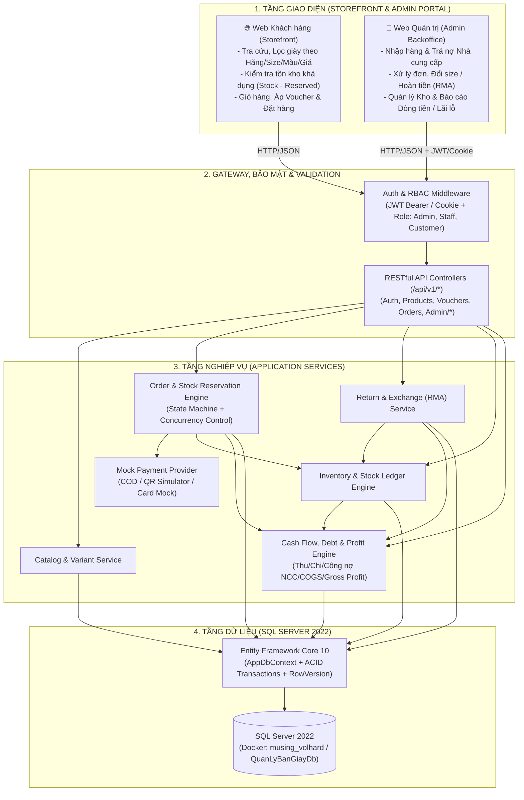

# BẢN ĐẶC TẢ KIẾN TRÚC HỆ THỐNG THƯƠNG MẠI ĐIỆN TỬ BÁN GIÀY
## (Modular Monolith + Decoupled REST API Architecture Specification)

---

### 1. TỔNG QUAN & MỤC TIÊU DỰ ÁN
Hệ thống **Quản Lý Bán Giày & Vận Hành Kinh Doanh Thương Mại** được thiết kế để đưa vào vận hành thực tế cho cửa hàng bán lẻ giày thể thao, quản trị khép kín từ khâu **Nhập hàng & Công nợ NCC -> Quản lý Kho theo Size/Màu -> Bán lẻ Storefront -> Đổi trả/Hoàn tiền -> Quản lý Dòng tiền (Thu/Chi/Lãi gộp)**.

Hệ thống tuân thủ 3 nguyên tắc kiến trúc thực dụng:
1. **Modular Monolith trên ASP.NET Core 10 (`QuanLyBanGiay.csproj`) + RESTful API tách lớp**:
   - Vận hành gọn nhẹ trên 1 Web App duy nhất (`QuanLyBanGiay`) để dễ triển khai và bảo trì cho shop, nhưng phân tách rạch ròi theo module (`Models/Entities`, `Data`, `Services`, `Controllers/Api`, `Views/Home`, `Views/Cart`, `Views/Admin`).
   - Toàn bộ nghiệp vụ cốt lõi được phục vụ qua **RESTful JSON API (`/api/v1/*`)**, sẵn sàng tách thành Frontend SPA/Mobile độc lập về sau.
2. **Bảo mật & Phân quyền chuẩn thương mại (Auth & RBAC)**:
   - Xác thực bằng **JWT Bearer** (cho API) và/hoặc Cookie Auth (cho Admin Portal), phân tách vai trò `Admin`, `Staff`, `Customer`.
   - Toàn bộ API quản trị (`/api/v1/admin/*`) và API mô phỏng thanh toán (`/api/v1/payments/mock-simulate`) bắt buộc xác thực quyền `Admin`/`Staff`.
3. **Tối ưu vận hành thực tế (Lean Operations)**:
   - **Bỏ hoàn toàn tính toán thuế (VAT = 0%)**: `TaxRate = 0`, `TaxAmount = 0`. `FinalTotal = Subtotal - DiscountAmount + ShippingFee`.
   - **Mô phỏng thanh toán (Mock Payment Engine)**: Tự chủ quy trình thanh toán giả lập (COD, Chuyển khoản VietQR mô phỏng, Thẻ mô phỏng) không phụ thuộc sandbox ngân hàng.

---

### 2. SƠ ĐỒ KIẾN TRÚC TỔNG THỂ (HIGH-LEVEL ARCHITECTURE)



---

### 3. CẤU TRÚC THƯ MỤC CHUẨN TRONG PROJECT (`QuanLyBanGiay`)

```text
QuanLyBanGiay/
├── Data/
│   ├── AppDbContext.cs          # EF Core DbContext, Fluent API, Constraints, Indexes
│   ├── DbInitializer.cs         # Seed dữ liệu mẫu (Admin user, Shoes, Variants, Suppliers, Vouchers)
│   └── Migrations/              # EF Core SQL Server Migrations
├── Models/
│   ├── Entities/                # Database Entities (User, Product, ProductVariant, Voucher, Order, ...)
│   ├── DTOs/                    # Request/Response Contracts & ApiResponse<T>
│   └── ViewModels/              # MVC ViewModels (Storefront & Admin)
├── Services/
│   ├── Auth/                    # Đăng nhập, tạo JWT, băm mật khẩu (PasswordHasher)
│   ├── Catalog/                 # Lọc sản phẩm, kiểm tra tồn khả dụng
│   ├── Inventory/               # Nhập kho, xuất kho, giữ chỗ, sổ cái InventoryTransactions
│   ├── Orders/                  # Đặt hàng, State Machine trạng thái đơn, Concurrency
│   ├── Returns/                 # Nghiệp vụ Đổi size & Hoàn tiền (RMA)
│   ├── Finance/                 # Sổ quỹ CashFlowLedger, Công nợ NCC, Báo cáo COGS & Lãi gộp
│   └── Payment/                 # Mock Payment Engine (COD, QR, Card)
├── Controllers/
│   ├── Api/                     # RESTful API Controllers (/api/v1/*)
│   ├── HomeController.cs        # Storefront Pages
│   ├── CartController.cs        # Cart & Checkout Pages
│   └── AdminController.cs       # Admin Backoffice Pages
├── Views/
│   ├── Home/
│   ├── Cart/
│   └── Admin/                   # Giao diện Quản trị Kho, Nhập hàng, Đơn hàng, Tài chính
└── wwwroot/                     # Assets, CSS, JS (Storefront & Admin Charts)
```

---

### 4. CƠ CHẾ THANH TOÁN MÔ PHỎNG & MIỄN THUẾ
1. **Miễn thuế (`VAT = 0%`)**:
   - Mọi đơn hàng áp dụng `TaxRate = 0`, `TaxAmount = 0`.
   - `TotalAmount = Subtotal - DiscountAmount + ShippingFee`.
2. **Mô phỏng thanh toán (`Mock Payment Engine`)**:
   - **COD**: Tạo đơn với `PaymentStatus = Pending`. Khi đơn chuyển sang `Completed` (đã giao & thu tiền), hệ thống tự động chuyển `PaymentStatus = Paid` và ghi phiếu thu `RECEIPT` vào `CashFlowLedger`.
   - **QR Code Chuyển khoản (`QR_TRANSFER`)**: Sinh thông tin QR kèm mã đơn `DH-YYYYMMDD-XXX` và số tiền. Endpoint xác nhận thanh toán `POST /api/v1/payments/mock-simulate` chỉ cho phép role `Admin`/`Staff` (hoặc môi trường `Development`) kích hoạt để tránh gian lận đơn hàng.
   - **Thẻ giả lập (`MOCK_CARD`)**: Hỗ trợ kiểm thử luồng thanh toán thành công/thất bại tức thì trong môi trường phát triển.
