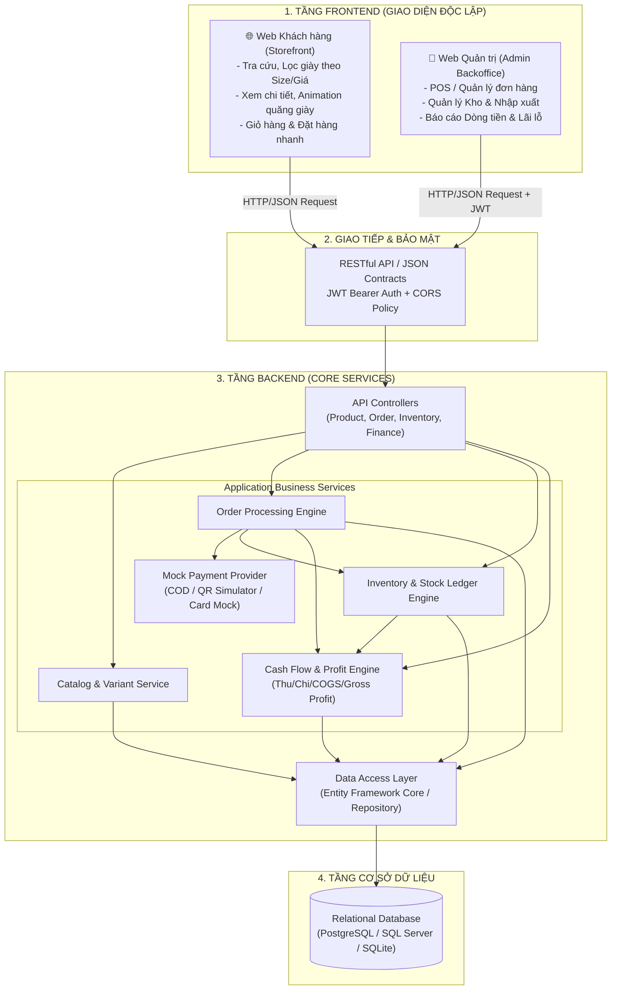

# BẢN ĐẶC TẢ KIẾN TRÚC HỆ THỐNG THƯƠNG MẠI ĐIỆN TỬ BÁN GIÀY
## (Decoupled Frontend - Backend Architecture Specification)

---

### 1. TỔNG QUAN & MỤC TIÊU DỰ ÁN
Hệ thống **Quản Lý Bán Giày & Vận Hành Kinh Doanh Thương Mại** được thiết kế nhằm mục đích đưa vào hoạt động kinh doanh thực tế, quản trị khép kín từ khâu **Nhập hàng -> Quản lý Kho -> Bán lẻ đa kênh -> Quản lý Dòng tiền (Thu/Chi/Lợi nhuận)**.

Hệ thống tuân thủ nghiêm ngặt 2 nguyên tắc kiến trúc:
1. **Tách biệt độc lập 1 chiều Frontend - 1 chiều Backend (Decoupled Client-Server via RESTful API)**: Backend hoàn toàn độc lập, đóng vai trò API Service & Business Logic Engine; Frontend đóng vai trò Consumer giao tiếp qua HTTP/JSON.
2. **Tối ưu vận hành thực tế (Lean Operations)**:
   - **Bỏ hoàn toàn tính toán thuế (VAT = 0%)** để tinh giản sổ sách, tránh phức tạp pháp lý cho cửa hàng bán lẻ cá nhân/hộ kinh doanh.
   - **Mô phỏng thanh toán (Mock/Sandbox Payment Engine)**: Không phụ thuộc vào tích hợp cổng thanh toán ngân hàng rườm rà (VNPay/Momo/Stripe sandbox phức tạp), hệ thống tự chủ xử lý quy trình thanh toán giả lập (COD, Chuyển khoản QR hiển thị mã đơn, Thẻ mô phỏng kiểm thử tức thì).

---

### 2. SƠ ĐỒ KIẾN TRÚC TỔNG THỂ (HIGH-LEVEL ARCHITECTURE)

---

### 3. NGUYÊN TẮC THIẾT KẾ 2 KHỐI ĐỘC LẬP

#### 3.1. Khối Backend (ASP.NET Core Web API)
- **Kiến trúc phân tầng (Clean Architecture / Layered Architecture)**:
  - `QuanLyBanGiay.Domain`: Chứa Entities, Enums, Value Objects (không phụ thuộc framework bên ngoài).
  - `QuanLyBanGiay.Application`: Chứa Business Interfaces, DTOs, Logic tính giá vốn hàng bán (COGS), công thức tính lãi lỗ, nghiệp vụ kho.
  - `QuanLyBanGiay.Infrastructure`: EF Core DbContext, Migrations, Mock Payment Providers, Loggers.
  - `QuanLyBanGiay.Api`: Controllers, Middleware xác thực, Bộ lọc Exception, Swagger/OpenAPI documentation.
- **Trách nhiệm duy nhất**: Trả về dữ liệu JSON có cấu trúc chuẩn, xử lý Transaction toàn vẹn (ACID) khi xuất nhập kho và ghi sổ dòng tiền.

#### 3.2. Khối Frontend (B2C Khách hàng & B2B Quản trị)
- **Storefront (Bán lẻ)**: Tập trung tốc độ, SEO, giao diện thể thao mượt mà (Nike/Adidas style), hiệu ứng bay giỏ hàng, responsive mobile.
- **Admin Portal (Quản trị)**: Giao diện bảng biểu (Data Grid), form nhập liệu nhanh, biểu đồ tài chính trực quan (Chart.js / ApexCharts), xuất hóa đơn bán lẻ, phiếu nhập kho.

---

### 4. CƠ CHẾ THANH TOÁN MÔ PHỎNG (MOCK PAYMENT) & MIỄN THUẾ
1. **Bỏ thuế (No Tax Policy)**:
   - Trường `TaxRate = 0`, `TaxAmount = 0` trên toàn hệ thống.
   - `FinalTotal = Subtotal - DiscountAmount + ShippingFee`.
2. **Mô phỏng thanh toán (Mock Payment Engine)**:
   - **COD (Thanh toán khi nhận hàng)**: Đơn tạo với trạng thái `PaymentStatus = Pending`. Khi shipper giao thành công, nhân viên bấm "Đã thu tiền" -> Kích hoạt ghi nhận Dòng tiền vào (Cash Inflow).
   - **QR Code Chuyển khoản (Mock VietQR)**: Sinh mã QR động chứa số tài khoản demo + Mã đơn hàng + Số tiền. Có nút "Mô phỏng đã nhận tiền chuyển khoản" trên giao diện Admin/Test để xác nhận thanh toán tự động trong 3 giây.
   - **Thẻ quốc tế / Nội địa giả lập**: Cho phép nhập số thẻ demo (ví dụ: `4242...`), chọn thành công/thất bại để kiểm thử luồng.
