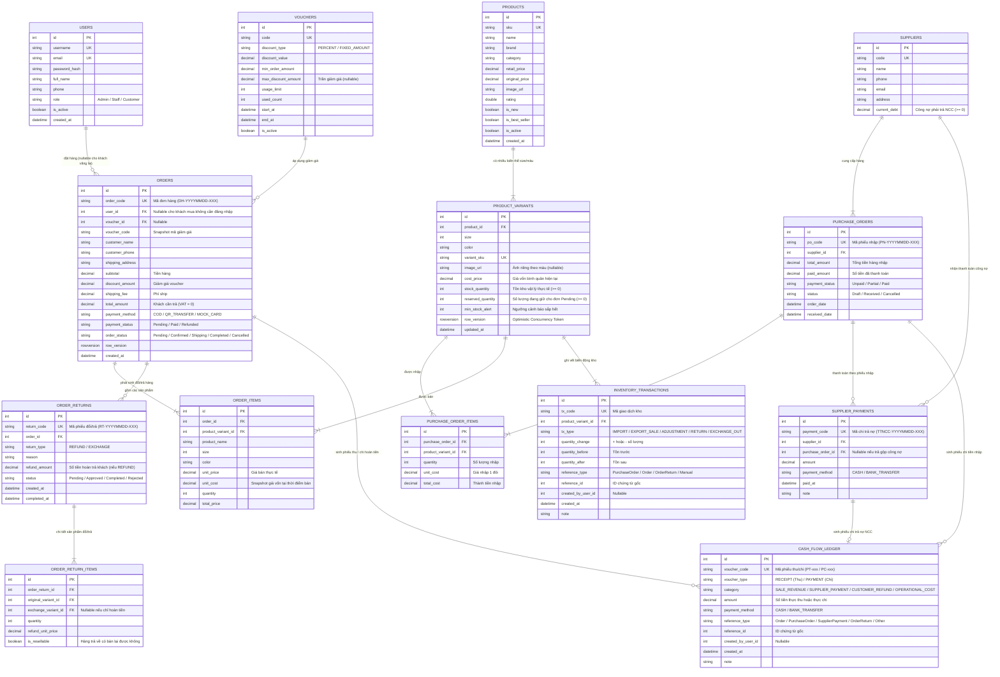

# HỢP ĐỒNG THIẾT KẾ CƠ SỞ DỮ LIỆU (DATABASE SCHEMA CONTRACT)
## Hệ Thống Quản Lý Bán Giày, Kho Hàng, Đổi Trả & Dòng Tiền (SQL Server 2022)

---

### 1. SƠ ĐỒ THỰC THỂ LIÊN KẾT (ENTITY RELATIONSHIP DIAGRAM)

---

### 2. CHI TIẾT CÁC BẢNG DỮ LIỆU & RÀNG BUỘC (DATA DICTIONARY)

#### 2.1. Nhóm Tài Khoản & Khuyến Mãi
1. **`Users`**: Lưu tài khoản đăng nhập cho `Admin`, `Staff`, `Customer`. Mật khẩu băm bằng `PasswordHasher` (PBKDF2/Argon2), không lưu plaintext.
2. **`Vouchers`**: Quản lý mã giảm giá động (`PERCENT` hoặc `FIXED_AMOUNT`), có kiểm tra thời hạn hiệu lực (`start_at`..`end_at`), ngưỡng đơn tối thiểu (`min_order_amount`), giới hạn lượt dùng (`used_count < usage_limit`).

#### 2.2. Nhóm Sản Phẩm & Biến Thể Kho (`Products`, `ProductVariants`)
* `ProductVariants` quản lý tồn kho theo cặp `(product_id, size, color)` (Unique Index).
* **Tồn kho khả dụng (Available Stock)**:
  $$\text{AvailableQuantity} = \text{stock\_quantity} - \text{reserved\_quantity}$$
* **Ràng buộc SQL Server**:
  * `CHECK (stock_quantity >= 0)`
  * `CHECK (reserved_quantity >= 0)`
  * `CHECK (stock_quantity >= reserved_quantity)`
  * `row_version ROWVERSION` chống ghi đè đồng thời (Optimistic Concurrency).

#### 2.3. Nhóm Nhập Hàng & Công Nợ Nhà Cung Cấp
* **`Suppliers`**: Lưu `current_debt` (`CHECK (current_debt >= 0)`).
* **`PurchaseOrders`** khi chuyển sang `Received`:
  * Tăng `stock_quantity`, cập nhật `cost_price` theo giá vốn bình quân gia quyền.
  * Ghi `InventoryTransactions` loại `IMPORT`.
  * Cộng dồn công nợ: `current_debt += (total_amount - paid_amount)`.
  * Nếu `paid_amount > 0`: ghi `CashFlowLedger` loại `PAYMENT`, category `SUPPLIER_PAYMENT`.
* **`SupplierPayments`**: Ghi nhận các đợt trả nợ bổ sung cho NCC, tự động giảm `Suppliers.current_debt`, cập nhật `PurchaseOrders.paid_amount` / `payment_status` và sinh phiếu chi `CashFlowLedger`.

#### 2.4. Nhóm Bán Hàng, Đổi Trả & Dòng Tiền
* **`Orders` & `OrderItems`**:
  * Lưu `OrderItems.unit_cost` (snapshot giá vốn tại thời điểm bán) để tính chính xác **Lợi nhuận gộp**:
    $$\text{Lợi nhuận gộp} = \sum (\text{unit\_price} - \text{unit\_cost}) \times \text{quantity} - \text{discount\_amount}$$
* **`OrderReturns` & `OrderReturnItems`**: Hỗ trợ hoàn tiền (`REFUND`) và đổi size/màu (`EXCHANGE`).
* **`InventoryTransactions` & `CashFlowLedger`**: Sổ cái bất biến (Append-only). Mọi biến động kho hoặc dòng tiền đều có `reference_type` và `reference_id` truy vết ngược về chứng từ gốc.
