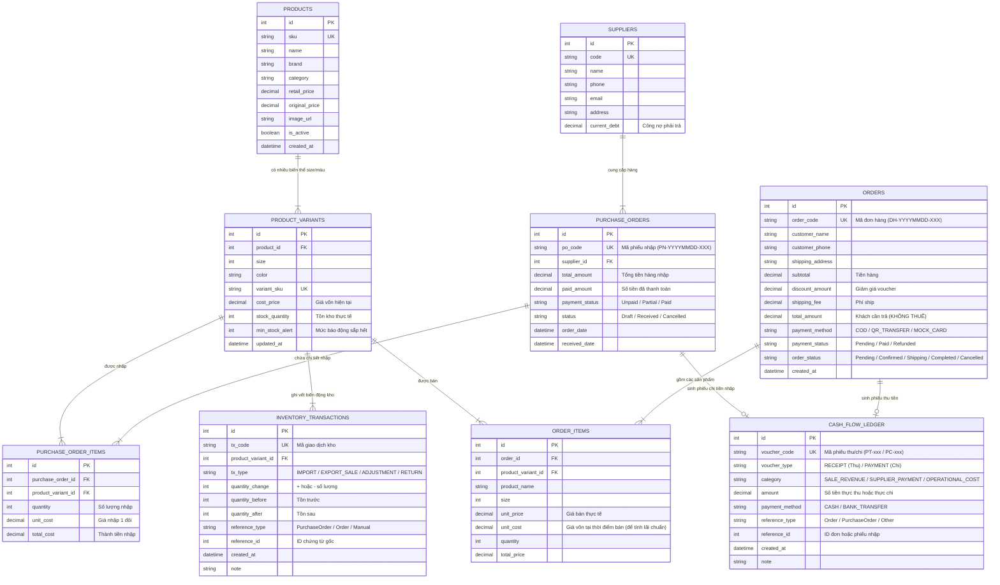

# HỢP ĐỒNG THIẾT KẾ CƠ SỞ DỮ LIỆU (DATABASE SCHEMA CONTRACT)
## Hệ Thống Quản Lý Bán Giày, Kho Hàng & Dòng Tiền Toàn Diện

---

### 1. SƠ ĐỒ THỰC THỂ LIÊN KẾT (ENTITY RELATIONSHIP DIAGRAM)

---

### 2. CHI TIẾT CÁC BẢNG DỮ LIỆU & RÀNG BUỘC (DATA DICTIONARY)

#### 2.1. Nhóm Quản Lý Sản Phẩm & Biến Thể Kho
1. **`Products`**: Lưu thông tin gốc của đôi giày (tên, hãng, danh mục, giá niêm yết, ảnh đại diện).
2. **`ProductVariants`**:
   - Quản lý chính xác từng **Size** (ví dụ: 39, 40, 41, 42, 43, 44).
   - `stock_quantity`: Số lượng giày vật lý hiện có trong kho.
   - `cost_price`: Giá vốn bình quân/giá nhập gần nhất của biến thể này.
   - Ràng buộc: `CHECK (stock_quantity >= 0)` (Ngăn chặn kho bị âm).

#### 2.2. Nhóm Quản Lý Nhập Hàng (Purchase Orders)
1. **`Suppliers`**: Danh bạ nhà cung cấp giày, xưởng sản xuất, đầu mối phân phối.
2. **`PurchaseOrders`** & **`PurchaseOrderItems`**:
   - Khi tạo phiếu nhập và bấm **"Xác nhận nhập kho" (Received)**:
     - Tự động tăng `stock_quantity` trong bảng `ProductVariants`.
     - Tự động ghi 1 dòng vào bảng `InventoryTransactions` với loại `IMPORT`.
     - Nếu đã thanh toán (`paid_amount > 0`): Tự động sinh 1 phiếu chi trong bảng `CashFlowLedger` với loại `PAYMENT` (Chi tiền nhập hàng).

#### 2.3. Nhóm Bán Hàng & Đơn Hàng (Orders)
1. **`Orders`** & **`OrderItems`**:
   - Bỏ hoàn toàn thuế (`Tax = 0`).
   - `OrderItems.unit_cost`: **Điểm mấu chốt tài chính!** Lưu snapshot giá vốn của đôi giày tại đúng thời điểm xuất bán. Nhờ đó, dù sau này giá nhập biến động, báo cáo lãi gộp của đơn hàng cũ vẫn chính xác 100%:
     $$\text{Lợi nhuận gộp đơn hàng} = \sum (\text{unit\_price} - \text{unit\_cost}) \times \text{quantity} - \text{discount\_amount}$$

#### 2.4. Nhóm Sổ Kho & Dòng Tiền (Core Operations & Financials)
1. **`InventoryTransactions` (Sổ cái kho)**:
   - Ghi nhận lịch sử bất biến (Immutable log). Bất kỳ khi nào kho tăng/giảm đều phải có 1 dòng ghi nhận ai làm, vì lý do gì, trước khi đổi là bao nhiêu, sau khi đổi là bao nhiêu.
2. **`CashFlowLedger` (Sổ quỹ dòng tiền)**:
   - Quản lý toàn bộ tiền thực vào/ra của cửa hàng:
     - **Thu (Receipt)**: Khách trả tiền đơn hàng (COD đối soát thành công, hoặc chuyển khoản thành công).
     - **Chi (Payment)**: Tiền trả cho nhà cung cấp khi nhập hàng, tiền chi phí vận hành (thuê mặt bằng, bao bì, đóng gói).
   - Công thức dòng tiền ròng (Net Cash Flow):
     $$\text{Dòng tiền thuần (Net Cash Flow)} = \sum \text{Tiền thu thực tế} - \sum \text{Tiền chi thực tế}$$
