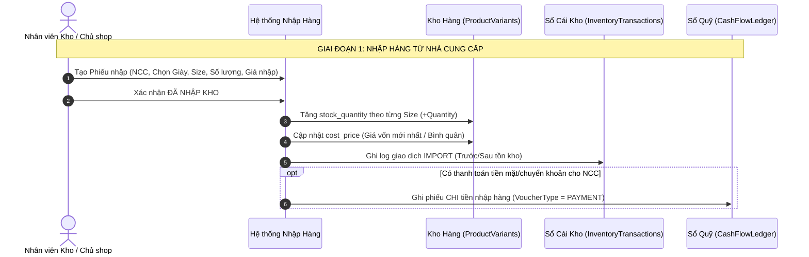
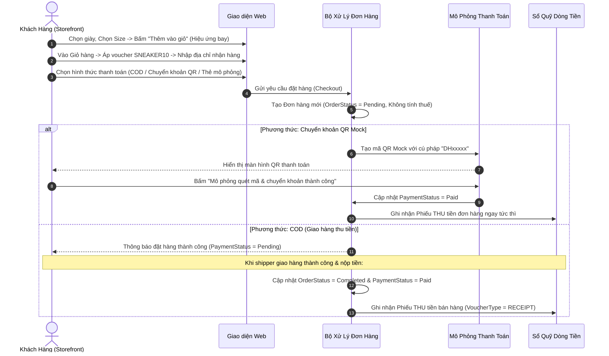

# ĐẶC TẢ QUY TRÌNH NGHIỆP VỤ KINH DOANH & CÔNG THỨC DÒNG TIỀN
## (Business Process Specification: Inventory, Sales & Cash Flow)

---

### 1. QUY TRÌNH QUẢN LÝ KHO (INVENTORY LIFECYCLE)

#### Quy tắc nghiệp vụ kho:
1. **Kiểm tra tồn kho thời gian thực**: Khi khách bấm "Thêm vào giỏ" hoặc "Đặt hàng", hệ thống kiểm tra `stock_quantity >= quantity` của size đó. Nếu bằng 0 -> Chặn đặt hàng và báo "Hết size".
2. **Trừ kho khi xác nhận đơn**:
   - Khi đơn chuyển sang trạng thái `Confirmed` (Đã duyệt đóng gói): Tự động trừ tồn kho (`stock_quantity = stock_quantity - quantity`).
   - Ghi nhận 1 dòng vào `InventoryTransactions` với loại `EXPORT_SALE` gắn với mã `OrderId`.
3. **Hủy đơn hoàn kho**: Nếu đơn hàng bị khách hủy trước khi giao hoặc giao thất bại (chuyển trạng thái `Cancelled`), hệ thống tự động cộng ngược tồn kho (`+quantity`) và ghi log `RETURN`.

---

### 2. QUY TRÌNH BÁN HÀNG & MÔ PHỎNG THANH TOÁN (SALES & MOCK PAYMENT)

---

### 3. CÔNG THỨC TÍNH TOÁN DÒNG TIỀN & BÁO CÁO TÀI CHÍNH KINH DOANH

Mục tiêu tối thượng của chủ shop là kiểm soát được **Doanh thu, Chi phí nhập hàng, Dòng tiền thực tế và Lợi nhuận bỏ túi**.

#### 3.1. Giá Vốn Hàng Bán (COGS - Cost of Goods Sold)
- Đối với mỗi đơn hàng hoàn tất:
$$\text{COGS}_{\text{order}} = \sum_{i=1}^{n} (\text{UnitCost}_i \times \text{Quantity}_i)$$
*(Trong đó $\text{UnitCost}_i$ là giá vốn của từng đôi giày được chốt lúc bán).*

#### 3.2. Doanh Thu Thuần (Net Revenue)
- Bỏ qua hoàn toàn thuế giá trị gia tăng (VAT = 0%):
$$\text{Doanh thu} = \sum (\text{Đơn giá bán} \times \text{Số lượng}) - \text{Giảm giá Voucher}$$

#### 3.3. Lợi Nhuận Gộp Kinh Doanh (Gross Profit)
$$\text{Lợi nhuận gộp} = \text{Doanh thu thuần} - \text{COGS}$$
$$\text{Tỷ suất lợi nhuận gộp (Gross Margin)} = \frac{\text{Lợi nhuận gộp}}{\text{Doanh thu thuần}} \times 100\%$$

#### 3.4. Dòng Tiền Thực Tế (Cash Flow Management)
Khác với lợi nhuận trên giấy tờ, dòng tiền là lượng **tiền mặt/tiền tài khoản thực sự chảy vào và chảy ra**:
- **Dòng tiền vào (Cash Inflow)**: Tổng tất cả các khoản thu tiền bán hàng thực tế đã nhận trong kỳ (các Phiếu Thu `RECEIPT`).
- **Dòng tiền ra (Cash Outflow)**: Tổng tiền thực chi để thanh toán đơn nhập hàng cho nhà cung cấp trong kỳ (các Phiếu Chi `PAYMENT`).
- **Dòng tiền thuần (Net Cash Flow)**:
$$\text{Net Cash Flow} = \text{Tổng Thu Thực Tế (Inflow)} - \text{Tổng Chi Thực Tế (Outflow)}$$

> [!IMPORTANT]
> **Quy tắc vàng phân biệt Lợi nhuận vs Dòng tiền**:
> - Nếu bán được 100 đôi giày giá 100 triệu (lãi 30 triệu) nhưng khách mua COD chưa nhận hàng, thì Lợi nhuận kế toán đã phát sinh nhưng **Dòng tiền thực tế vẫn là 0đ**.
> - Bảng điều khiển tài chính (Financial Dashboard) sẽ hiển thị song song 2 chỉ số: **Lợi nhuận ước tính** và **Số dư dòng tiền thực tế** để chủ shop không bao giờ bị hụt tiền nhập hàng!
