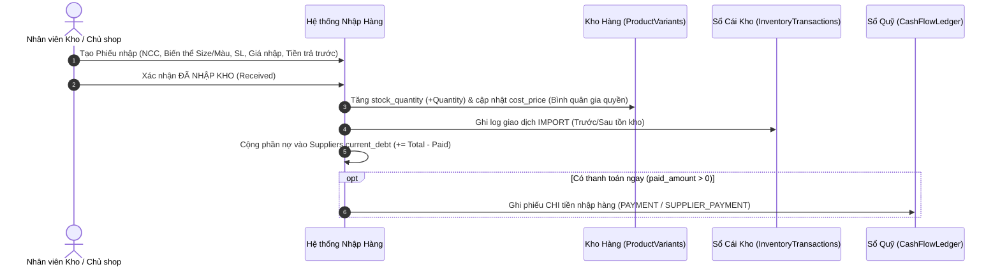
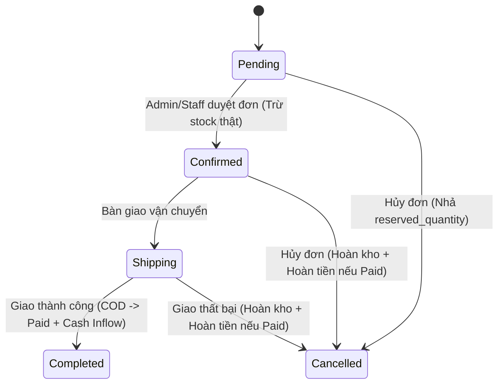

# ĐẶC TẢ QUY TRÌNH NGHIỆP VỤ KINH DOANH & CÔNG THỨC DÒNG TIỀN
## (Business Process Specification: Inventory, Reservation, RMA, Debt & Cash Flow)

---

### 1. QUY TRÌNH NHẬP HÀNG & CÔNG NỢ NHÀ CUNG CẤP

#### Công thức tính Giá vốn bình quân gia quyền (Weighted Average Cost):
$$\text{CostPrice}_{\text{mới}} = \frac{(\text{Stock}_{\text{cũ}} \times \text{CostPrice}_{\text{cũ}}) + (\text{Qty}_{\text{nhập}} \times \text{UnitCost}_{\text{nhập}})}{\text{Stock}_{\text{cũ}} + \text{Qty}_{\text{nhập}}}$$

#### Trả nợ Nhà cung cấp bổ sung (`SupplierPayments`):
* Khi shop trả thêm tiền nợ cho NCC: giảm `Suppliers.current_debt`, cập nhật `PurchaseOrders.paid_amount` & `payment_status` (`Unpaid -> Partial -> Paid`), đồng thời sinh phiếu chi `PAYMENT / SUPPLIER_PAYMENT` trong `CashFlowLedger`.

---

### 2. QUY TRÌNH GIỮ CHỖ TỒN KHO, ĐẶT HÀNG & STATE MACHINE ĐƠN HÀNG

Để ngăn chặn tuyệt đối tình trạng **2 khách cùng đặt đôi giày cuối cùng (Overselling)**, hệ thống áp dụng cơ chế **Giữ chỗ tồn kho (Stock Reservation)** trong DB Transaction:

1. **Bước Tạo đơn (`Pending`)**:
   - Kiểm tra `stock_quantity - reserved_quantity >= quantity` trên `ProductVariants` (dùng `ROWVERSION` hoặc `UPDATE ... WHERE (stock_quantity - reserved_quantity) >= @qty`).
   - Nếu đủ: tăng `reserved_quantity += quantity` ngay lập tức. Nếu không đủ: rollback và báo hết hàng.
   - Validate và khóa lượt dùng `Voucher` (nếu có).
2. **Bước Xác nhận đóng gói (`Pending -> Confirmed`)**:
   - Chuyển giữ chỗ thành xuất kho thật: `stock_quantity -= quantity` và `reserved_quantity -= quantity`.
   - Ghi 1 dòng vào `InventoryTransactions` loại `EXPORT_SALE`.
3. **Bước Giao hàng & Hoàn tất (`Confirmed -> Shipping -> Completed`)**:
   - Với đơn **COD**: Khi `Completed` (đã giao & thu tiền), tự động cập nhật `PaymentStatus = Paid` và ghi phiếu thu `RECEIPT / SALE_REVENUE` vào `CashFlowLedger`.
   - Với đơn **QR_TRANSFER / MOCK_CARD**: Khi thanh toán thành công, cập nhật `PaymentStatus = Paid` và ghi phiếu thu `RECEIPT / SALE_REVENUE` ngay tại thời điểm thu tiền.
4. **Bước Hủy đơn (`Cancelled`)**:
   - Nếu hủy từ `Pending` (chưa xuất kho): chỉ giải phóng giữ chỗ `reserved_quantity -= quantity`.
   - Nếu hủy từ `Confirmed` hoặc `Shipping` (đã trừ kho): cộng hoàn tồn kho `stock_quantity += quantity`, ghi `InventoryTransactions` loại `RETURN`. Nếu đơn đã `Paid`, tự động sinh phiếu chi `PAYMENT / CUSTOMER_REFUND` và đổi `PaymentStatus = Refunded`.

#### Sơ đồ State Machine hợp lệ cho `order_status`:

> **Ràng buộc bắt buộc**: Không cho phép chuyển từ `Cancelled` hoặc `Completed` sang bất kỳ trạng thái nào khác để bảo toàn sổ kho và sổ quỹ.

---

### 3. QUY TRÌNH ĐỔI SIZE & TRẢ HÀNG HOÀN TIỀN (RMA)

Chỉ áp dụng cho đơn hàng đã ở trạng thái `Completed`:
1. **Đổi Size / Đổi Mẫu (`EXCHANGE`)**:
   - Kiểm tra biến thể mới còn đủ `AvailableQuantity >= quantity`.
   - Nếu `is_resellable = true`: cộng `stock_quantity` cho biến thể cũ (`RETURN`), trừ `stock_quantity` biến thể mới (`EXCHANGE_OUT`), ghi đầy đủ 2 dòng vào `InventoryTransactions`.
   - Nếu có chênh lệch giá (nếu đổi sang mẫu khác): ghi nhận thu thêm (`RECEIPT`) hoặc chi trả lại (`PAYMENT`) vào `CashFlowLedger`.
2. **Trả hàng hoàn tiền (`REFUND`)**:
   - Nếu `is_resellable = true`: cộng lại `stock_quantity` và ghi `InventoryTransactions` loại `RETURN`.
   - Ghi phiếu chi `PAYMENT` (category `CUSTOMER_REFUND`) vào `CashFlowLedger` đúng bằng `refund_amount`.
   - Cập nhật `Orders.payment_status = Refunded`.

---

### 4. CÔNG THỨC TÀI CHÍNH & DÒNG TIỀN KINH DOANH

* **Giá vốn hàng bán (COGS)**:
  $$\text{COGS} = \sum (\text{OrderItem.UnitCost} \times \text{OrderItem.Quantity})$$
* **Doanh thu thuần (Net Revenue, VAT = 0%)**:
  $$\text{Doanh thu thuần} = \sum (\text{OrderItem.UnitPrice} \times \text{OrderItem.Quantity}) - \text{DiscountAmount}$$
* **Lợi nhuận gộp (Gross Profit)**:
  $$\text{Lợi nhuận gộp} = \text{Doanh thu thuần} - \text{COGS}$$
* **Dòng tiền thuần (Net Cash Flow)**:
  $$\text{Net Cash Flow} = \sum \text{Phiếu Thu (RECEIPT)} - \sum \text{Phiếu Chi (PAYMENT)}$$
  *(Bao gồm chi nhập hàng `SUPPLIER_PAYMENT`, chi hoàn tiền khách `CUSTOMER_REFUND`, chi vận hành `OPERATIONAL_COST`).*
