# KẾ HOẠCH TRIỂN KHAI & PHÂN CÔNG GIAO VIỆC CHO ĐỘI THỢ AI
## (Implementation Roadmap & AI Worker Dispatch Matrix — SQL Server 2022)

---

### 1. HẠ TẦNG & ĐỘI HÌNH TRIỂN KHAI
* **Cơ sở dữ liệu**: SQL Server 2022 chạy trên Docker container `musing_volhard` (`localhost,1433`), database `QuanLyBanGiayDb`.
* **Kiến trúc code**: Modular Monolith trên `QuanLyBanGiay.csproj` (ASP.NET Core 10).
* **Đội hình AI Workers**:
  1. **`antigravity-cli` (Tech Lead / Architect & Reviewer)**: Chia task, tạo worktree, xử lý nghiệp vụ phức tạp (Concurrency, RMA, Admin UI), review diff, chạy `dotnet build` / `dotnet test` và merge về `main`.
  2. **`codex-local` (Backend & Data Engineer)**: Thiết kế EF Core Entities, `AppDbContext`, Migrations, Auth/RBAC, Inventory & Finance Services.
  3. **`github-copilot-executive` (API & Frontend Engineer)**: Xây dựng REST API Controllers, Storefront tích hợp API, hoặc bộ test tích hợp (sau khi xác nhận auth CLI).

---

### 2. PHÂN CHIA CÁC GIAI ĐOẠN (PROJECT PHASES)

```mermaid
flowchart TD
    P1["GIAI ĐOẠN 1: SQL SERVER, EF CORE & AUTH/RBAC<br/>- Kết nối SQL Server (musing_volhard / QuanLyBanGiayDb)<br/>- Entities đầy đủ (Users, Products, Variants, Vouchers, PO, Orders, Returns, Ledgers)<br/>- Migrations + Seed Data + Auth JWT/Cookie"]

    P2["GIAI ĐOẠN 2: LÕI NGHIỆP VỤ KHO, ĐƠN HÀNG & DÒNG TIỀN<br/>- InventoryService (Nhập kho, Giá vốn bình quân, Sổ cái kho)<br/>- OrderService (Stock Reservation + RowVersion + State Machine)<br/>- RmaService (Đổi size / Hoàn tiền) & CashFlowService (Sổ quỹ / Công nợ NCC)"]

    P3["GIAI ĐOẠN 3: BỘ REST API & SWAGGER/OPENAPI<br/>- Auth, Storefront & Voucher APIs<br/>- Admin APIs (Inventory, PO, Suppliers, Orders, Returns, Finance)<br/>- Bảo vệ bằng [Authorize(Roles = 'Admin,Staff')]"]

    P4["GIAI ĐOẠN 4: NÂNG CẤP STOREFRONT THƯƠNG MẠI<br/>- Chuyển Home/Cart từ dữ liệu tĩnh sang EF Core / REST API<br/>- Hiển thị tồn kho khả dụng theo Size/Màu, áp Voucher động<br/>- Màn hình Thanh toán COD / QR Mock"]

    P5["GIAI ĐOẠN 5: ADMIN BACKOFFICE PORTAL<br/>- Đăng nhập Admin, Dashboard Dòng tiền & Lãi gộp (Chart.js)<br/>- Quản lý Kho, Nhập hàng, Công nợ NCC, Xử lý Đơn & Đổi/Trả"]

    P6["GIAI ĐOẠN 6: KIỂM THỬ TỔNG THỂ & BÀN GIAO<br/>- Test kịch bản E2E: Nhập 100 đôi -> Giữ chỗ/Bán -> Đổi size -> Hoàn tiền -> Kiểm tra Sổ quỹ<br/>- Kiểm tra Concurrency chống bán âm kho & push GitHub"]

    P1 --> P2 --> P3 --> P4 --> P5 --> P6
```

---

### 3. MA TRẬN PHÂN CÔNG TÁC VỤ CHO CÁC THỢ AI (DISPATCH MATRIX)

Mỗi task chạy trên git worktree riêng với phạm vi file (`file_globs`) tách biệt để tránh xung đột khi merge:

| STT | Tên Task & Mục tiêu | Thợ AI phụ trách | Phạm vi file (`File Globs`) | Tiêu chí nghiệm thu (Acceptance Criteria) |
| :--- | :--- | :--- | :--- | :--- |
| **T1** | **EF Core Entities, `AppDbContext`, SQL Server Migration & Seed** | `codex-local` | `Models/Entities/**/*`, `Data/**/*`, `QuanLyBanGiay.csproj`, `Program.cs` | Đầy đủ 13 bảng theo `02_DATABASE_SCHEMA_CONTRACT.md` (có `Users`, `Vouchers`, `OrderReturns`, `SupplierPayments`, `RowVersion`, `CHECK` constraints). `dotnet ef database update` lên `musing_volhard` thành công + seed data chạy sạch. |
| **T2** | **Auth Service & JWT/Cookie RBAC** | `codex-local` | `Services/Auth/**/*`, `Models/DTOs/Auth/**/*`, `Controllers/Api/AuthController.cs` | Đăng nhập, đăng ký Customer, sinh JWT, băm mật khẩu an toàn, phân quyền `Admin`/`Staff`/`Customer`. |
| **T3** | **Inventory, PO & Supplier Debt Engine** | `codex-local` | `Services/Inventory/**/*`, `Services/Finance/**/*` | Nhập kho tăng tồn + tính giá vốn bình quân + ghi `InventoryTransactions` + cộng công nợ NCC; trả nợ NCC; tính đúng Doanh thu, COGS, Lãi gộp, Net Cash Flow (`VAT = 0`). |
| **T4** | **Order Reservation, State Machine, RMA & Mock Payment** | `antigravity-cli` | `Services/Orders/**/*`, `Services/Returns/**/*`, `Services/Payment/**/*` | Giữ chỗ `reserved_quantity` chống overselling bằng transaction/concurrency, chuyển trạng thái hợp lệ, đổi size/hoàn tiền cập nhật đúng kho & sổ quỹ, mô phỏng COD/QR/Card. |
| **T5** | **Bộ REST API Controllers & Validation** | `github-copilot-executive` *(hoặc `codex-local`)* | `Controllers/Api/**/*`, `Models/DTOs/**/*` | Triển khai đầy đủ Endpoints theo `04_API_CONTRACT_SPECIFICATION.md`, trả về `ApiResponse<T>` chuẩn, khóa `[Authorize]` cho toàn bộ `/api/v1/admin/*` và `mock-simulate`. |
| **T6** | **Chuyển Storefront (Home/Cart) sang DB/API thật** | `github-copilot-executive` | `Controllers/HomeController.cs`, `Controllers/CartController.cs`, `Views/Home/**/*`, `Views/Cart/**/*`, `wwwroot/js/**/*` | Bỏ phụ thuộc `ShoeDataService` / `CartService` in-memory; kiểm tra tồn khả dụng theo Size/Màu, áp Voucher động từ DB, giữ nguyên hiệu ứng bay giỏ hàng. |
| **T7** | **Admin Backoffice Portal & Financial Charts** | `antigravity-cli` | `Controllers/AdminController.cs`, `Views/Admin/**/*`, `wwwroot/css/admin*`, `wwwroot/js/admin*` | Giao diện Admin: Nhập kho, Trả nợ NCC, Duyệt đơn & Đổi trả, Dashboard biểu đồ Doanh thu / Lãi gộp / Dòng tiền. |
| **T8** | **Integration Tests & Concurrency Verification** | `codex-local` + `antigravity-cli` | `Tests/**/*` | Kiểm thử tự động toàn bộ luồng Nhập -> Bán -> Hủy -> Đổi size -> Hoàn tiền -> Báo cáo dòng tiền + test 2 request đặt cùng đôi giày cuối cùng không bị âm kho. |

---

### 4. QUY TRÌNH BÀN GIAO VẬN HÀNH
Sau khi hoàn tất 6 giai đoạn:
1. **Storefront**: Khách hàng xem giày, lọc theo hãng/size/màu/giá, kiểm tra tồn kho thật, áp voucher, đặt hàng và thanh toán.
2. **Admin Portal**: Chủ shop/nhân viên đăng nhập quản lý nhập hàng, công nợ NCC, duyệt đơn, xử lý đổi size/hoàn tiền và theo dõi tồn kho cảnh báo.
3. **Trung tâm Tài chính & Dòng tiền**: Hiển thị minh bạch Doanh thu thuần, Giá vốn, Lãi gộp và Tiền mặt/Ngân hàng thực thu – thực chi.
