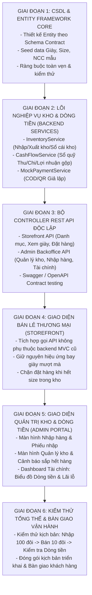

# KẾ HOẠCH TRIỂN KHAI & PHÂN CÔNG GIAO VIỆC CHO ĐỘI THỢ AI
## (Implementation Roadmap & AI Worker Dispatch Matrix)

---

### 1. PHÂN CHIA CÁC GIAI ĐOẠN (PROJECT PHASES)

---

### 2. MA TRẬN PHÂN CÔNG TÁC VỤ CHO CÁC THỢ AI (DISPATCH MATRIX)

Với vai trò **Tech Lead**, em sẽ điều hành và giao từng task có phạm vi file (file_globs) rõ ràng vào hệ thống DevAgent Orchestrator:

| STT | Tên Task & Mục tiêu | Thợ AI phụ trách | Phạm vi file (File Globs) | Tiêu chí nghiệm thu (Acceptance Criteria) |
| :--- | :--- | :--- | :--- | :--- |
| **T1** | **Xây dựng Data Layer & EF Core Models** | `github-copilot-executive` | `Data/**/*`, `Models/**/*` | Đầy đủ Entities: `ProductVariant`, `Supplier`, `PurchaseOrder`, `InventoryTransaction`, `CashFlowLedger`. Chạy `dotnet ef` hoặc khởi tạo in-memory/sqlite thành công. |
| **T2** | **Cơ chế Nghiệp vụ Kho & Tính Giá Vốn (Inventory Engine)** | `antigravity-cli` | `Services/Inventory/**/*` | Có logic nhập kho tự tăng tồn, xuất kho tự giảm tồn, ghi sổ `InventoryTransactions`, cập nhật giá vốn bình quân. Unit test logic kho pass 100%. |
| **T3** | **Cơ chế Sổ Quỹ & Dòng Tiền (Cash Flow Engine)** | `github-copilot-executive` | `Services/Finance/**/*` | Tính chuẩn: Doanh thu thuần, COGS, Lợi nhuận gộp, Tiền thực thu, Tiền thực chi, Net Cash Flow. Bỏ hoàn toàn thuế. |
| **T4** | **Mock Payment Engine (Thanh toán mô phỏng)** | `antigravity-cli` | `Services/Payment/**/*` | Xử lý COD, sinh mã QR VietQR giả lập, có API bấm "Mô phỏng chuyển khoản thành công" đổi trạng thái trong 3s. |
| **T5** | **Bộ REST API Controllers** | `github-copilot-executive` | `Controllers/Api/**/*` | Triển khai các Endpoint độc lập theo đúng tài liệu `04_API_CONTRACT_SPECIFICATION.md`. Trả về JSON envelope chuẩn. |
| **T6** | **Giao diện Admin Dashboard & Báo cáo Dòng tiền** | `antigravity-cli` | `Views/Admin/**/*`, `wwwroot/**/*` | Hiển thị bảng tồn kho, tạo phiếu nhập hàng, biểu đồ Thu/Chi trực quan. |

---

### 3. QUY TRÌNH BÀN GIAO & VẬN HÀNH CHO KHÁCH HÀNG (HANDOVER CHECKLIST)
Khi hoàn tất 6 giai đoạn trên, sản phẩm bàn giao cho khách hàng kinh doanh sẽ bao gồm:
1. **Web Bán Hàng (Storefront)**: Khách vào xem giày, chọn size chuẩn tồn kho, ném giày vào giỏ hàng, đặt hàng thanh toán nhanh.
2. **Hệ Thống Quản Trị Kho (Inventory ERP)**: Kiểm soát số lượng từng size, cảnh báo nhập khi sắp hết hàng, quản lý danh sách nhà cung cấp và lịch sử phiếu nhập.
3. **Báo Cáo Tài Chính & Dòng Tiền (Cash Flow Center)**: Giúp chủ shop mở máy lên là biết chính xác:
   - Hôm nay bán được bao nhiêu tiền.
   - Tiền thực tế đã về túi là bao nhiêu (đã trừ tiền nhập hàng).
   - Lãi gộp thực tế là bao nhiêu mà không cần thuê kế toán phức tạp.
